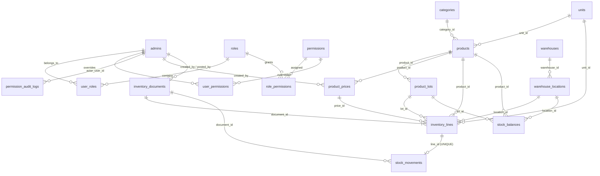

# Báo cáo Nghiệm thu Hệ thống Quản lý Kho, Giá theo Thời gian & Phân quyền PHP

Tài liệu tổng hợp kiến trúc dữ liệu, quy tắc nghiệp vụ bổ sung, sơ đồ quan hệ (ERD), ma trận phân quyền, truy vấn chứng minh, bằng chứng đối soát, hướng dẫn xuất ảnh/PDF in phiếu và bảng ca kiểm thử thực tế đáp ứng [DE_XUAT_MO_RONG.md](DE_XUAT_MO_RONG.md) và [BAI_TAP_SINH_VIEN.md](BAI_TAP_SINH_VIEN.md) trên khung mã nguồn chuẩn của môn học.

---

## 1. Kiến trúc & Sơ đồ quan hệ dữ liệu (ERD)

Toàn bộ lược đồ chạy trên MySQL 8.0+ (InnoDB) qua bộ cài mới ([database/init.sql](../database/init.sql)) và 2 script nâng cấp tăng dần:
- [001_inventory_access.sql](../database/migrations/001_inventory_access.sql): nâng cấp từ lược đồ 3 bảng cũ (`admins`, `categories`, `products`) sang RBAC, kho/vị trí/lô/đơn vị, giá lịch sử và chứng từ nhập/xuất.
- [002_e7_access_and_catalog.sql](../database/migrations/002_e7_access_and_catalog.sql): bổ sung `admins.is_active`, `permission_audit_logs`, và `is_active` cho `units`, `warehouses`, `warehouse_locations`, `product_lots`.



---

## 2. Thiết kế các hạng mục bắt buộc (Bài A – Bài D)

### Bài A — Phân trang thực trên Database & Sổ biến động kho
- **Phân trang DB thực:** Trong `product_paginate()` ([product_repository.php](../app/src/product_repository.php)), câu lệnh `SELECT COUNT(*)` và `SELECT ... LIMIT :per_page OFFSET :offset` dùng chung `$where` và `$params` (`keyword`, `category_id`). Thứ tự luôn cố định theo khóa chính `ORDER BY p.id DESC`, `pagination_meta()` ([helpers.php](../app/src/helpers.php)) kẹp `per_page` từ `1..100` và `page` từ `1..pages`.
- **Dữ liệu thực hành đủ lớn:** Script [tests/seed_practice.php](../tests/seed_practice.php) nạp an toàn tổng cộng **39 sản phẩm** qua **3 danh mục** (`Laptop`, `Điện thoại`, `Phụ kiện`), 2 kho (`MAIN`, `SUB`), 4 vị trí, lô theo hạn dùng và lô hết hạn, cùng nhiều khoảng giá liên tiếp.
- **Sổ biến động chỉ đọc:** Route `/inventory/movements` gọi `inventory_movements_paginate()` ([inventory_repository.php](../app/src/inventory_repository.php)) và render [app/views/inventory/movements.php](../app/views/inventory/movements.php), hỗ trợ lọc theo `product_id`, `warehouse_id`, khoảng ngày chứng từ `from_date`–`to_date`, từ khóa số phiếu/sản phẩm, và phân trang hoàn toàn ở database.

### Bài B — Phân quyền RBAC (`deny > allow > group > default deny`) & Truy vấn chứng minh
Hàm `permission_decide()` và `permission_for_user()` trong [permission_repository.php](../app/src/permission_repository.php) kiểm tra quyền trực tiếp từ DB trên mỗi request (không lưu quyền trong `$_SESSION`), đồng thời `current_user()` ([auth.php](../app/src/auth.php)) kiểm tra lại `is_active = 1` ở mọi request:
1. Tài khoản không tồn tại hoặc `is_active != 1` → **Từ chối** (`false`) và vô hiệu phiên ngay lập tức.
2. Có `user_permissions(user_id, permission_id, 'deny')` → **Từ chối** (`false`).
3. Có `user_permissions(user_id, permission_id, 'allow')` → **Cho phép** (`true`).
4. Có ít nhất một nhóm trong `user_roles` cấp quyền qua `role_permissions` → **Cho phép** (`true`).
5. Mặc định → **Từ chối** (`false`).

**Truy vấn SQL chứng minh quyền hiệu lực cho tài khoản bất kỳ (`clerk`):**

```sql
SELECT
    a.username,
    a.is_active,
    p.code AS permission_code,
    up.effect AS direct_effect,
    GROUP_CONCAT(DISTINCT r.code ORDER BY r.id SEPARATOR ', ') AS granted_by_roles,
    CASE
        WHEN a.is_active != 1 THEN 0
        WHEN up.effect = 'deny' THEN 0
        WHEN up.effect = 'allow' THEN 1
        WHEN COUNT(DISTINCT rp.role_id) > 0 THEN 1
        ELSE 0
    END AS effective_allowed
FROM admins a
CROSS JOIN permissions p
LEFT JOIN user_permissions up
    ON up.user_id = a.id AND up.permission_id = p.id
LEFT JOIN user_roles ur
    ON ur.user_id = a.id
LEFT JOIN role_permissions rp
    ON rp.role_id = ur.role_id AND rp.permission_id = p.id
LEFT JOIN roles r
    ON r.id = rp.role_id
WHERE a.username = 'clerk'
GROUP BY a.id, a.username, a.is_active, p.id, p.code, up.effect
ORDER BY p.id ASC;
```

**Ma trận 16 quyền × 4 nhóm mặc định (khớp `001_inventory_access.sql`):**

| Mã quyền | `ADMIN` | `STOCK_CLERK` | `STOCK_MANAGER` | `VIEWER` |
|---|:---:|:---:|:---:|:---:|
| `dashboard.view` | ✓ | ✓ | ✓ | ✓ |
| `products.view` | ✓ | ✓ | ✓ | ✓ |
| `products.manage` | ✓ | — | — | — |
| `categories.view` | ✓ | ✓ | ✓ | ✓ |
| `categories.manage` | ✓ | — | — | — |
| `inventory.view` | ✓ | ✓ | ✓ | ✓ |
| `warehouse.manage` | ✓ | — | ✓ | — |
| `prices.view` | ✓ | ✓ | ✓ | ✓ |
| `prices.manage` | ✓ | — | — | — |
| `documents.view` | ✓ | ✓ | ✓ | ✓ |
| `receipts.create` | ✓ | ✓ | — | — |
| `receipts.post` | ✓ | — | ✓ | — |
| `issues.create` | ✓ | ✓ | — | — |
| `issues.post` | ✓ | — | ✓ | — |
| `documents.print` | ✓ | ✓ | ✓ | — |
| `access.manage` | ✓ | — | — | — |

### Bài C — Lịch sử giá `[valid_from, valid_to)` & Chống giả mạo đơn giá
- Tra cứu đơn giá dùng khoảng nửa kín `valid_from <= :start AND (valid_to IS NULL OR valid_to > :end)`.
- Tạo/đóng giá khóa dòng `products` bằng `SELECT id FROM products WHERE id=? FOR UPDATE` trong `run_with_deadlock_retry()` trước khi kiểm tra chồng khoảng `price_assert_no_overlap()`.
- Server tự tra `price_id` và `unit_price` theo `document_date` khi lập phiếu nháp, bỏ qua mọi giá trị giá gửi từ client.
- Múi giờ `+07:00` (`Asia/Ho_Chi_Minh`) được đồng bộ trong [config.php](../app/src/config.php) và [db.php](../app/src/db.php) (`SET time_zone = '+07:00'`).

### Bài D — Chứng từ nhập/xuất, khóa số dư & đối soát tồn
- Lưu nháp (`draft`) chụp `product_name`, `sku`, `unit_name`, `location_label`, `lot_code`, `unit_price`, `price_id` vào `inventory_lines`; **chưa đổi** `stock_balances` / `stock_movements`.
- Khi ghi sổ (`document_post()` trong [inventory_repository.php](../app/src/inventory_repository.php)):
  1. Bọc toàn bộ trong `run_with_deadlock_retry()` (thử lại toàn transaction tối đa `maxRetries=2` lần khi gặp SQLSTATE `40001` / error `1213` / `1205`).
  2. Khóa `inventory_documents` `FOR UPDATE`, kiểm tra quyền `receipts.post`/`issues.post` và `status === 'draft'`.
  3. Khóa `products` và `product_lots` theo thứ tự ID tăng dần; kiểm tra hạn lô (`expires_on`) với cả `document_date` và ngày hiện tại khi xuất.
  4. Gom số lượng theo từng bộ khóa `(product_id, location_id, lot_id)` và **sắp xếp khóa tăng dần (`%010d:%010d:%010d`, `ksort`)** trước khi `SELECT ... FOR UPDATE` trên `stock_balances`.
  5. Ghi `stock_movements` (ràng buộc `UNIQUE(line_id)` chống ghi trùng) và cập nhật trạng thái `posted`.

---

## 3. Phần mở rộng đã triển khai: Đặc tả, Schema, Màn hình & Nghiệm thu

### 3.1. Extension E7 — Quản lý tài khoản, nhật ký phân quyền và danh mục an toàn
- **Quy tắc nghiệp vụ bổ sung:**
  1. Chỉ tài khoản có quyền `access.manage` mới tạo/cập nhật/khóa-mở khóa/đổi mật khẩu tài khoản, tạo/đổi tên nhóm, sửa quyền và xem nhật ký phân quyền.
  2. Tài khoản bị khóa (`is_active = 0`) bị từ chối khi đăng nhập (`admin_login()`) và bị vô hiệu phiên ngay lập tức trong `current_user()` ở request tiếp theo.
  3. Chặn tự khóa tài khoản đang thao tác, tự thu hồi `access.manage`, và chặn mọi thao tác làm hệ thống không còn ít nhất 1 tài khoản `is_active = 1` có quyền `access.manage` (`access_assert_active_manager_exists()`).
  4. Mọi thao tác trên `/access` ghi nhận chi tiết vào `permission_audit_logs` trong cùng transaction.
  5. Danh mục đã có tham chiếu chứng từ/sản phẩm/tồn kho không thể xóa (`warehouse_delete_safe()`); riêng lô mặc định `NOLOT` không được xóa hoặc ngừng sử dụng. Có thể sửa inline tên kho/đơn vị, `Khu/Kệ/Ô`, hoặc hạn lô (`warehouse_update()`) và chuyển trạng thái `is_active = 0` (`warehouse_toggle_active()`) mà **không làm đổi thông tin chụp (`location_label`, `unit_name`, `lot_code`) trên chứng từ lịch sử**.
- **Thay đổi schema ([002_e7_access_and_catalog.sql](../database/migrations/002_e7_access_and_catalog.sql)):**
  - `admins.is_active TINYINT(1) NOT NULL DEFAULT 1`
  - Bảng `permission_audit_logs (id, actor_user_id, target_type, target_id, target_label, action, details, ip_address, created_at)`
  - Cột `is_active TINYINT(1) NOT NULL DEFAULT 1` trên `units`, `warehouses`, `warehouse_locations`, `product_lots`.
- **Màn hình đã hoàn thiện:**
  - `/access?tab=permissions|users|roles|audit` ([app/views/access/index.php](../app/views/access/index.php))
  - `/warehouse-catalog?tab=warehouses|locations|lots|units` ([app/views/warehouse/index.php](../app/views/warehouse/index.php))
- **Ca nghiệm thu E7 (đã kiểm chứng qua `integration_extended.php` & `concurrency_test.py`):**
  1. *(Khóa tài khoản đang giữ session)* Khóa User B qua `/access?tab=users` → `GET /documents` kế tiếp của User B nhận `302 -> /login`.
  2. *(Bảo vệ admin cuối cùng & tự thu hồi)* Thử tự khóa hoặc tự gỡ `access.manage` của `admin` → ném `InvalidArgumentException`, rollback nguyên vẹn.
  3. *(Nhật ký phân quyền)* Tạo user, gán quyền, khóa/mở khóa, tạo/sửa nhóm đều ghi vào `permission_audit_logs`.
  4. *(Danh mục ngừng dùng & bất biến bản chụp khi sửa danh mục)* Ngừng dùng `units` → tạo sản phẩm mới chọn đơn vị đó bị từ chối; sửa tên đơn vị `CAI` bằng `warehouse_update()` không làm thay đổi `unit_name` đã chụp trên `OPENING-MIGRATION-001`.
  5. *(Chống xóa danh mục đang tham chiếu & `NOLOT`)* Xóa đơn vị `CAI` hoặc khóa/xóa `NOLOT` đều bị từ chối; xóa kho/vị trí/đơn vị chưa phát sinh tham chiếu thành công.

### 3.2. Lựa chọn mở rộng — Đóng khoảng mở & Lập giá kế tiếp nguyên tử (`price_close_and_open_next`)
- **Quy tắc nghiệp vụ:**
  1. Khóa dòng sản phẩm `FOR UPDATE`, tìm khoảng giá mở (`valid_to IS NULL`) của `(product_id, price_type)`.
  2. Bắt buộc thời điểm chuyển tiếp `T > open.valid_from`; đóng khoảng cũ (`valid_to = T`), kiểm tra `price_assert_no_overlap()`, rồi chèn khoảng mới `[T, valid_to)` trong cùng transaction.
  3. Nếu bất kỳ bước nào lỗi → rollback toàn bộ, giữ nguyên khoảng mở cũ và giá chụp trên các chứng từ cũ.
- **Màn hình:** Khung **Đóng khoảng mở & Lập mức giá kế tiếp (Nguyên tử)** tại `/prices` ([app/views/prices/index.php](../app/views/prices/index.php)).

---

## 4. Bảng ca kiểm thử & Kết quả thực tế (đã chạy trên bản mã cuối)

Các lệnh kiểm thử đã chạy trực tiếp sau chỉnh sửa mã cuối cùng:
- Cú pháp PHP toàn bộ `/var/www/html`: `php -l` tất cả file `.php` → **không có lỗi cú pháp (`LINT_OK`)**.
- Bộ test chuẩn [tests/integration.php](../tests/integration.php) trên `admin_product_test`: **70 checks passed**.
- Bộ test mở rộng [tests/integration_extended.php](../tests/integration_extended.php) trên `admin_product_test`: **26 checks passed**.
- Bộ test HTTP smoke [tests/http_smoke.py](../tests/http_smoke.py) trên `http://localhost:8090`: **31 HTTP checks passed**.
- Bộ test cạnh tranh 2 session độc lập [tests/concurrency_test.py](../tests/concurrency_test.py) trên `http://localhost:8090`: **34 assertions PASSED** (gồm xuất kho đồng thời, trùng khoảng giá, đóng/mở giá nguyên tử, post-vs-cancel, khóa session sống và xuất CSV UTF-8 BOM).

| Mã ca | Hạng mục | Dữ liệu đầu vào / Thao tác | Kết quả mong đợi | Kết quả thực tế |
|---|---|---|---|---|
| **A1** | Phân trang, lọc & xuất CSV | 3 SP trùng tên ở 2 danh mục, `per_page=1`, trang cuối/quá trang (`integration.php`), 39 SP từ `seed_practice.php`, `/products?export=csv` | Đúng `total`, không trùng ID giữa các trang, quá trang kẹp về trang cuối, xuất CSV UTF-8 BOM | **PASS** (`integration.php`, `integration_extended.php`, `concurrency_test.py`) |
| **A2** | Sổ biến động chỉ đọc & CSV | Truy vấn `inventory_movements_paginate()`, `GET /inventory/movements`, `export=csv` | Phân trang DB đúng tổng, đúng bộ lọc, xuất CSV hợp lệ, không đổi tồn kho | **PASS** (`integration_extended.php`, `concurrency_test.py`) |
| **B1** | Ưu tiên RBAC | Thử nhóm cấp, `deny` đè nhóm, `allow` không nhóm, thu hồi quyền, mặc định deny | Đúng thứ tự `deny > allow > group > deny`, hiệu lực ở request sau | **PASS** (`integration.php`, `http_smoke.py`) |
| **B2** | CSRF 419 & chặn quyền | `POST` thiếu CSRF, `VIEWER` gọi `/access`, `/prices`, `STOCK_CLERK` gọi `POST /documents/post` | Thiếu CSRF trả **HTTP 419**, trái quyền trả **HTTP 403** | **PASS** (`http_smoke.py` 31/31) |
| **E7-1** | Khóa tài khoản online | Admin khóa `conc_b` (`is_active=0`) khi session B đang giữ cookie hợp lệ | Request `GET /documents` kế tiếp của session B chuyển `302 -> /login` | **PASS** (`concurrency_test.py`) |
| **E7-2** | Bảo vệ manager cuối & audit | Tự khóa / tự gỡ `access.manage` của `admin`; xem `permission_audit_logs` | Bị từ chối; audit log ghi đủ thao tác user/role | **PASS** (`integration_extended.php`, `concurrency_test.py`) |
| **E7-3** | Ngừng dùng & xóa an toàn | Ngừng dùng unit chặn SP mới; chặn xóa `CAI` & khóa/xóa `NOLOT`; cho xóa unit/kho rỗng | Đúng ràng buộc an toàn danh mục | **PASS** (`integration_extended.php`) |
| **C1** | Giá `[from, to)` & chống sửa giá | Biên tiếp giáp, chồng khoảng, giá âm, quá 2 số lẻ, giả mạo `unit_price` | Chụp đúng giá tại `document_date`, chặn mọi khoảng giao nhau | **PASS** (`integration.php`) |
| **C2** | Đóng/mở giá nguyên tử | `price_close_and_open_next()` tại `T <= valid_from` (lỗi) và `T > valid_from` (thành công) | Lỗi rollback giữ `valid_to=NULL`; thành công đóng cũ tại `T` và mở mới tại `T` | **PASS** (`integration_extended.php`) |
| **D1** | Nháp / Ghi sổ / Hủy / Hạn lô | Nháp nhiều dòng trùng khóa, xuất vượt tồn, xuất lô quá hạn, phiếu lùi ngày, bất biến `posted` | Đủ mới trừ kho; sai rollback toàn phiếu; in nháp bị chặn | **PASS** (`integration.php`, `http_smoke.py`) |
| **CC1** | Cạnh tranh xuất 2 session | Balance = `4`, 2 session độc lập (`CookieJar` + CSRF riêng) gửi đồng thời `POST /documents/post` xuất `4` | Đúng `[302, 422]`: 1 `posted`, 1 giữ `draft`, tồn = `0`, 2 movement (`+4`, `-4`) | **PASS** (`concurrency_test.py`) |
| **CC2** | Ghi sổ lặp | Gửi lại `POST /documents/post` cho phiếu đã `posted` | Trả **HTTP 422**, tồn vẫn `0`, không tăng biến động | **PASS** (`concurrency_test.py`) |
| **CC3** | Cạnh tranh giá & `close_open` | 2 session đồng thời chèn giá giao nhau và đồng thời `close_open` cùng khoảng mở | Mỗi phép thử chỉ 1 request thành công (`302`), 1 request báo lỗi (`200`), không trùng giá | **PASS** (`concurrency_test.py`) |
| **CC4** | Cạnh tranh Post vs Cancel | 2 session gửi đồng thời `POST /documents/post` và `POST /documents/cancel` trên cùng phiếu nháp | Đúng `[302, 422]`: loại trừ lẫn nhau, tồn khớp trạng thái cuối | **PASS** (`concurrency_test.py`) |
| **CC5** | Deadlock retry toàn transaction | Giả lập SQLSTATE `40001` (1213/1205) qua `run_with_deadlock_retry()` | Thành công ở lần thử thứ 3 khi `maxRetries=2`; ném lại lỗi sau khi hết `maxRetries=2` | **PASS** (`integration_extended.php`) |

---

## 5. Bằng chứng đối soát tồn & thử nghiệm nâng cấp database cũ

### 5.1. Thử nghiệm nâng cấp database 3 bảng cũ (`admin_product_upgrade_test`)
Nạp lược đồ 3 bảng ban đầu (`admin`, 3 danh mục, 3 sản phẩm tổng tồn `45`), rồi chạy tuần tự `001_inventory_access.sql` → `002_e7_access_and_catalog.sql`:
- `schema_migrations`: ghi đủ `001_inventory_access` và `002_e7_access_and_catalog`.
- `admins`: giữ nguyên tài khoản `admin` (`is_active = 1`), **không tự thêm** `clerk`/`manager`/`viewer` vào dữ liệu cũ.
- Chứng từ đầu kỳ: tạo `OPENING-MIGRATION-001` (`status = 'posted'`).
- Đối soát số lượng chuyển đổi: `legacy_product_stock_prices` = `45`, `stock_balances` = `45`, `stock_movements` = `45`.

### 5.2. Đối soát sau khi chạy kiểm thử và nạp dữ liệu thực hành
Kết quả truy vấn trực tiếp trên MySQL cuối phiên kiểm thử:

| Database | Số sản phẩm | `SUM(stock_balances.quantity)` | `SUM(stock_movements.quantity)` | `SUM(receipt - issue)` phiếu `posted` |
|---|---:|---:|---:|---:|
| `admin_product_db` (đã chạy `seed_practice.php`) | `39` | `93` | `93` | `93` |
| `admin_product_test` (sau `integration.php` + `integration_extended.php`) | `4` | `45` | `45` | — |

---

## 6. Ảnh màn hình chính & In phiếu mẫu

Toàn bộ ảnh chụp màn hình và bản PDF in phiếu mẫu đã được xuất trực tiếp bằng trình duyệt Microsoft Edge từ giao diện mới tại `http://localhost:8090`, lưu trong [docs/submissions/](submissions/):

- **Ảnh các màn hình chính (13 ảnh full-page):**
  - [01_login.png](submissions/01_login.png) — Đăng nhập hệ thống
  - [02_dashboard.png](submissions/02_dashboard.png) — Dashboard tổng quan tồn kho (`39` SP, `2` kho, tổng tồn `93`)
  - [03_products_pagination.png](submissions/03_products_pagination.png) — Danh sách sản phẩm phân trang DB (`Trang 2/4`), nút Xuất CSV & Lịch sử giá
  - [04_warehouse_catalog.png](submissions/04_warehouse_catalog.png) — Danh mục kho/vị trí/lô/đơn vị (sửa inline, ngừng dùng, chống xóa đang tham chiếu)
  - [05_prices.png](submissions/05_prices.png) — Lịch sử giá `[Từ, Đến)` & khung đóng khoảng mở lập giá mới nguyên tử
  - [06_documents.png](submissions/06_documents.png) — Danh sách phiếu nhập/xuất kèm số dòng & tổng tiền
  - [07_document_detail.png](submissions/07_document_detail.png) — Chi tiết phiếu `OPENING-MIGRATION-001` đã ghi sổ
  - [08_inventory_balances.png](submissions/08_inventory_balances.png) — Chi tiết tồn theo kho/vị trí/lô kèm đối soát tự động `Khớp 100%`
  - [09_inventory_movements.png](submissions/09_inventory_movements.png) — Sổ biến động kho chỉ đọc phân trang DB & xuất CSV
  - [10_access_rbac.png](submissions/10_access_rbac.png) — Phân quyền chi tiết nhóm (`ADMIN`, `STOCK_CLERK`, `STOCK_MANAGER`, `VIEWER`) và ngoại lệ `UserPermission`
  - [12_access_users.png](submissions/12_access_users.png) — Quản lý tài khoản, khóa/mở khóa và đổi mật khẩu (E7)
  - [13_access_audit.png](submissions/13_access_audit.png) — Nhật ký thay đổi tài khoản & phân quyền (`permission_audit_logs`)
  - [11_document_print_preview.png](submissions/11_document_print_preview.png) — Giao diện xem trước khi in phiếu `/documents/print?id=1`
- **Bản PDF in phiếu mẫu từ trình duyệt:**
  - [phieu_mau_OPENING-MIGRATION-001.pdf](submissions/phieu_mau_OPENING-MIGRATION-001.pdf) — Xuất từ `/documents/print?id=1` (khổ A4 ngang, ẩn thanh điều hướng/nút, hiển thị đủ 3 dòng hàng chụp lịch sử với tổng giá trị `275.000.000,00 đ` và 4 chữ ký).

---

## 7. Giới hạn còn lại (Chưa triển khai)

- Chưa có giới hạn dữ liệu hoặc phân quyền theo từng kho (**E1**).
- Chưa có quy trình trình duyệt (`submitted`) hay chặn người lập tự duyệt / tự ghi sổ phiếu (**E2**).
- Chưa có nghiệp vụ chuyển kho nội bộ (**E3**), đảo phiếu / trả hàng (**E4**), quy đổi nhiều đơn vị tính (**E5**), hoặc tính giá vốn FIFO / bình quân gia quyền & khóa kỳ kế toán (**E6**).
